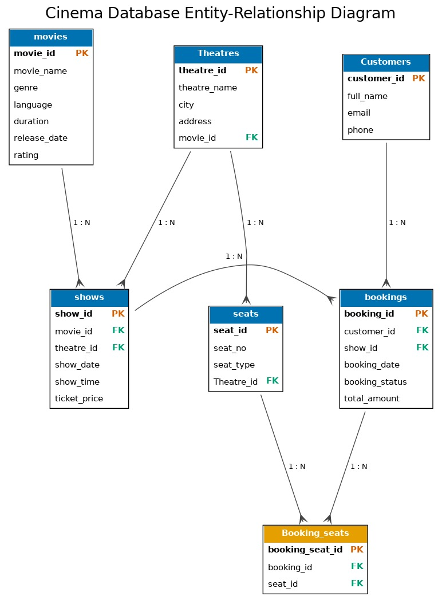

<h1 align="center">🎬 Movie Ticket Booking System</h1>

<p align="center">
  A MySQL database project that handles movies, theatres, shows, seats, customers and bookings,<br>
  with data cleaning, joins, transactions, triggers and views.
</p>

<p align="center">
  
  
  
  
</p>

---

## 📑 Table of contents

- [About the project](#-about-the-project)
- [Features](#-features)
- [ER diagram](#-er-diagram)
- [Database tables](#-database-tables)
- [How to run](#-how-to-run)
- [Sample queries and output](#-sample-queries-and-output)
- [Trigger in action](#-trigger-in-action)
- [What I learned](#-what-i-learned)

---

## 📌 About the project

Booking a movie ticket looks simple, but behind it there are many connected pieces: which movie is playing, in which theatre, at what time, which seats are free and who booked them.

This project designs that whole system as a relational database. It starts from a hand drawn ER diagram, turns it into tables, and then practices the most important SQL operations on it, from cleaning messy data to preventing a seat from being sold twice.

---

## ✨ Features

| No | Operation | What it does in this project |
|:--:|-----------|------------------------------|
| 1 | 🧹 Remove duplicates | Deletes repeated movie and customer rows using a self join |
| 2 | ✅ Check constraints | Rating between 0 and 10, ticket price above 0, valid booking status |
| 3 | 🔗 Foreign keys | Links all tables so a wrong id can never be inserted |
| 4 | 🩹 Null value cleaning | Fills missing genre, phone and price, then makes columns NOT NULL |
| 5 | 🤝 Joins | Full booking details from 6 tables, movies with no shows |
| 6 | 🔍 Subqueries | Customers above average spending, highest priced show |
| 7 | 💳 Transactions | Books seats with COMMIT, cancel example with ROLLBACK |
| 8 | 🚨 Trigger | Blocks the same seat from being booked twice for one show |
| 9 | 👁️ Views | `v_booking_details` and `v_movie_revenue` for quick reports |

---

## 🗺️ ER diagram



### How the tables are related

| Relationship | Type | Meaning |
|--------------|:----:|---------|
| movies → shows | 1:M | One movie can have many shows |
| theatres → shows | 1:M | One theatre hosts many shows |
| theatres → seats | 1:M | One theatre has many seats |
| customers → bookings | 1:M | One customer can make many bookings |
| shows → bookings | 1:M | One show can have many bookings |
| bookings → booking_seats | 1:M | One booking can contain many seats |
| seats → booking_seats | 1:M | One seat can be used in many bookings |

Two many to many relations are split using linking tables:

- **movies and theatres** are connected through `shows`
- **bookings and seats** are connected through `booking_seats`

---

## 🗃️ Database tables

| Table | Purpose | Key columns |
|-------|---------|-------------|
| `movies` | Movie details | movie_id, movie_name, genre, language, rating |
| `theatres` | Theatre locations | theatre_id, theatre_name, city |
| `shows` | A movie playing in a theatre at a time | show_id, movie_id, theatre_id, ticket_price |
| `seats` | Seats of each theatre | seat_id, seat_no, seat_type |
| `customers` | People who book tickets | customer_id, full_name, email |
| `bookings` | One booking by one customer for one show | booking_id, customer_id, show_id, total_amount |
| `booking_seats` | Which seats belong to which booking | booking_id, seat_id |

---

## 🚀 How to run

**1.** Install MySQL 8.0.16 or newer (older versions ignore CHECK constraints)

**2.** Clone this repository

```bash
git clone https://github.com/your-username/movie-ticket-booking-sql.git
cd movie-ticket-booking-sql
```

**3.** Run the script

```bash
mysql -u root -p < sql/movie_booking.sql
```

You can also open `sql/movie_booking.sql` in MySQL Workbench and press the execute button.

> ⚠️ Run the script only once. To start again, drop the database first:
> ```sql
> drop database movie_booking;
> ```

---

## 📊 Sample queries and output

### Customers who spent more than the average booking

```sql
select c.full_name, b.total_amount
from customers c
join bookings b on c.customer_id = b.customer_id
where b.total_amount > (select avg(total_amount) from bookings);
```

| full_name | total_amount |
|-----------|-------------:|
| Rahul Das | 500.00 |

### Show with the highest ticket price

```sql
select s.show_id, m.movie_name, t.theatre_name, s.ticket_price
from shows s
join movies m   on s.movie_id = m.movie_id
join theatres t on s.theatre_id = t.theatre_id
where s.ticket_price = (select max(ticket_price) from shows);
```

| show_id | movie_name | theatre_name | ticket_price |
|:-------:|------------|--------------|-------------:|
| 2 | Jawan | INOX South City | 300.00 |

### Revenue of each movie (view)

```sql
select * from v_movie_revenue;
```

| movie_name | total_bookings | revenue |
|------------|:--------------:|--------:|
| Leo | 1 | 500.00 |
| Jawan | 1 | 300.00 |

---

## 🚨 Trigger in action

The trigger `trg_check_seat` runs before every insert into `booking_seats`. If the seat is already booked for the same show, it stops the insert.

```sql
insert into booking_seats (booking_id, seat_id) values (5, 4);
```

```
Error Code: 1644. This seat is already booked for the show
```

---

---

## 💡 What I learned

- Splitting many to many relations using linking tables
- Cleaning messy data before adding constraints
- Writing joins, subqueries, transactions, triggers and views
- Why a join without an `ON` condition gives wrong repeated rows
- How a trigger can protect data that constraints alone cannot

---

<p align="center">⭐ If this project helped you, give it a star!</p>
